<div align="center">

# 小呆象棋 · XiaoDai Xiangqi

**一款完全离线运行的中国象棋 Android 应用**

人机对弈 · 双人同屏 · 本地 Pikafish 引擎 · 离线中文语音 · 无广告 · 零网络请求


[**⬇️ 下载安装包（v3.0）**](https://github.com/xiaoxu-tongxue/xiaoxu-xiangqi/releases/latest) ·
[**▶️ 功能演示（32 秒）**](https://raw.githubusercontent.com/xiaoxu-tongxue/xiaoxu-xiangqi/main/docs/images/demo.mp4) ·
[**🐞 反馈问题**](https://github.com/xiaoxu-tongxue/xiaoxu-xiangqi/issues)

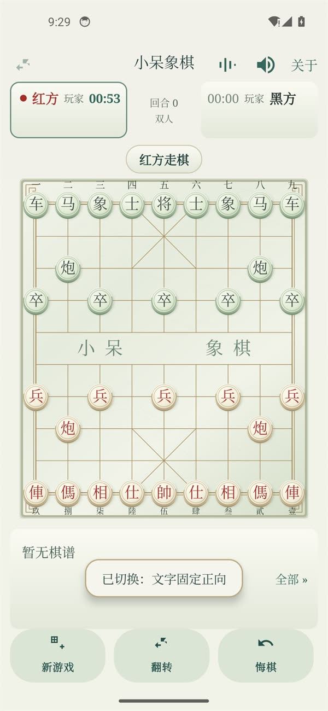
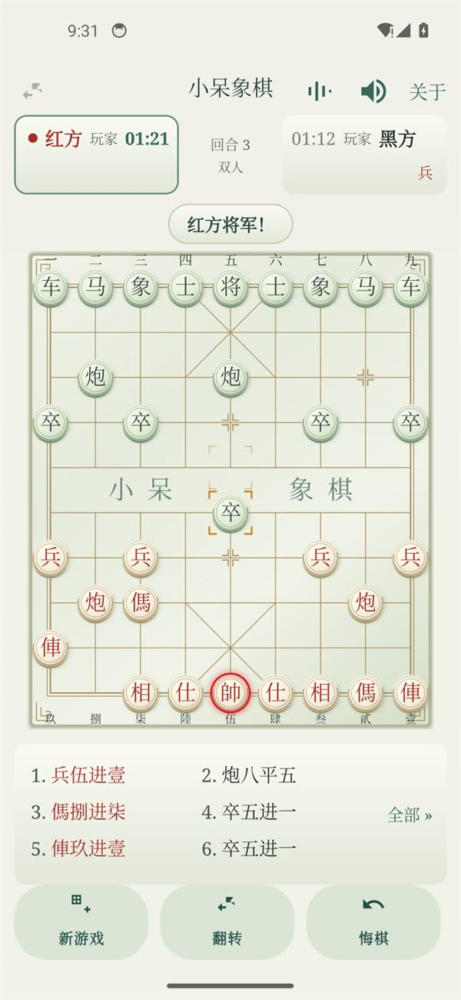
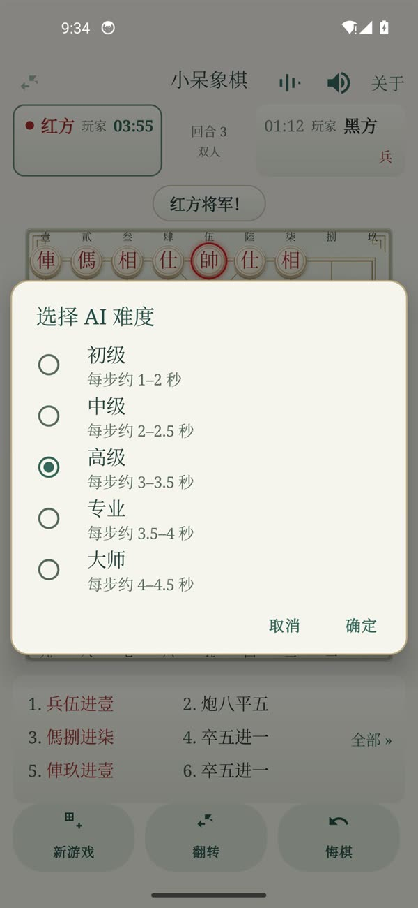

</div>

---

## 目录

- [为什么是小呆象棋](#为什么是小呆象棋)
- [功能演示：32 秒看完整局](#功能演示32-秒看完整局)
- [逐项图解：每一个功能长什么样](#逐项图解每一个功能长什么样)
- [功能一览](#功能一览)
- [走法提示速查表](#走法提示速查表)
- [应用信息](#应用信息)
- [下载与安装](#下载与安装)
- [从源码构建](#从源码构建)
- [项目结构](#项目结构)
- [技术架构](#技术架构)
- [可选二进制资源](#可选二进制资源)
- [常见问题](#常见问题)
- [版本说明](#版本说明)
- [参与贡献](#参与贡献)
- [许可证](#许可证)
- [免责声明](#免责声明)

---

## 为什么是小呆象棋

市面上的象棋 App 大多要联网、要看广告、要登录账号，棋力与规则判定还常常说不清。小呆象棋反其道而行：

| 特点 | 具体表现 |
| --- | --- |
| 🔌 **完全离线** | 清单文件不申请网络权限，AI 计算、语音合成、规则判定全部在手机本地完成 |
| 🚫 **没有广告与推送** | 无内购、无账号体系、无任何付费入口，打开即下棋 |
| 🧠 **本地棋力引擎** | 内置皮卡鱼（Pikafish）引擎，五档难度共用同一引擎，按思考时长分层 |
| 🗣️ **会说话的棋** | 离线中文语音播报落子、吃子、将军、杀招名与胜负 |
| 🧾 **讲道理的规则** | 走错的每一步都告诉你错在哪：别马腿、塞象眼、炮缺炮架、兵不能后退…… |
| 🧹 **纯净源码仓库** | 源码只有 Kotlin / XML / Gradle 文本，仓库内二进制仅限 README 展示图，安装包一律走 Releases |

---

## 功能演示：32 秒看完整局

<div align="center">

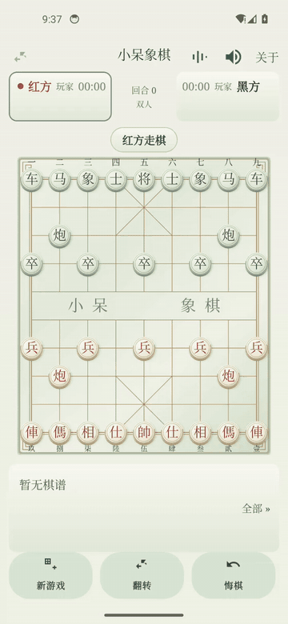

</div>

```text
0–4s    双人对局开局，红方在下方，双方棋钟独立计时
4–9s    选中棋子 → 准星标出全部可行落点，并标注该步的记谱写法（进七 / 退五）
9–12s   把兵推到第二格 → 弹出提示「兵只能向前走一步」，不执行该步
12–18s  正常走子：兵五进一 → 炮八平五 → 傌八进七，记谱实时生成
18–25s  黑卒吃兵，形成炮打底线的将军，状态条变为「红方将军！」并将/帅被红圈标出
25–28s  被将军时去动别的子 → 提示「将军！须走应将着法」
28–32s  悔棋确认弹窗 → 取消 → 一键翻转棋盘视角
```

> 完整视频（720×1560，32 秒，约 350 KB）：[demo.mp4](https://raw.githubusercontent.com/xiaoxu-tongxue/xiaoxu-xiangqi/main/docs/images/demo.mp4)

---

## 逐项图解：每一个功能长什么样

### 1. 选择模式：人机还是双人

<div align="center">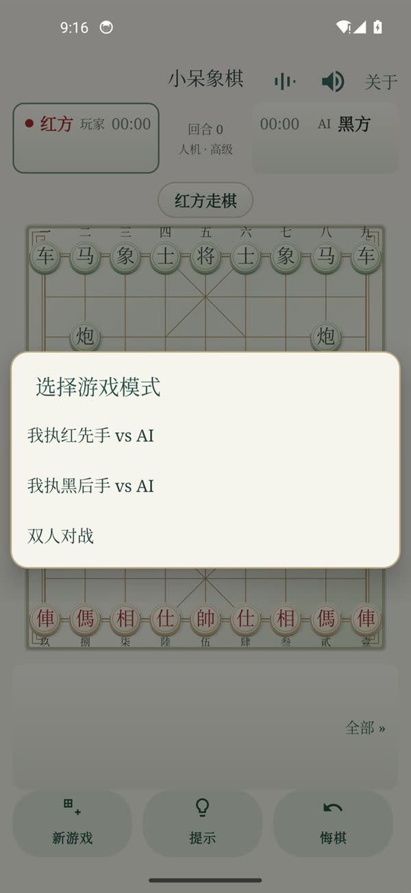</div>

<div align="center"><sub>图 1 · 选择对战模式</sub></div>

启动即进入模式选择：**我执红先手 vs AI**、**我执黑后手 vs AI**、**双人对战**。顶栏「小呆象棋」居中；左上角是**文字朝向**按钮（仅双人对战出现），右侧依次为语音播报、声音总开关与「关于」。

### 2. 五档难度，棋力靠思考时长分层

<div align="center"></div>

<div align="center"><sub>图 2 · 选择 AI 难度</sub></div>

| 档位 | 每步思考 | 适合谁 |
| --- | --- | --- |
| 初级 | 约 1–2 秒 | 刚学走法、熟悉规则 |
| 中级 | 约 2–2.5 秒 | 能走完一整局的新手 |
| 高级 | 约 3–3.5 秒 | 有基础的爱好者 |
| 专业 | 约 3.5–4 秒 | 会算两三层变化 |
| 大师 | 约 4–4.5 秒 | 想被认真对待 |

同一档位内思考时长还会随局面复杂度自适应：局面简明时偏快，纠缠、被将军或兑子时偏慢，且不越出该档区间。

<div align="center">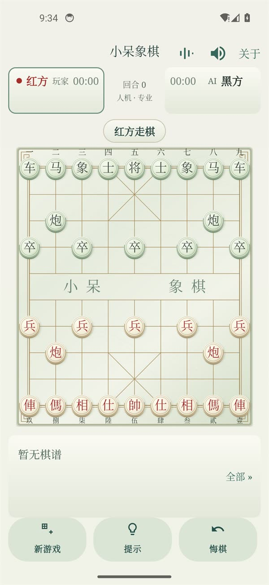</div>

<div align="center"><sub>图 3 · 人机对局（专业档）</sub></div>

进入人机对局后，两侧卡片标出「玩家」「AI 黑方」与「人机 · 专业」；底部按钮为 **新游戏 / 提示 / 悔棋**——「提示」只在人机模式出现，点它会先本地思考约 4.5–5.5 秒，再给出一步参考着法（提示条写明「建议走 …」）。**执黑后手时棋盘会自动翻成黑方视角**，红方在上，不必自己动手翻。

### 3. 选中即所见：可行落点 + 走法标注

<div align="center">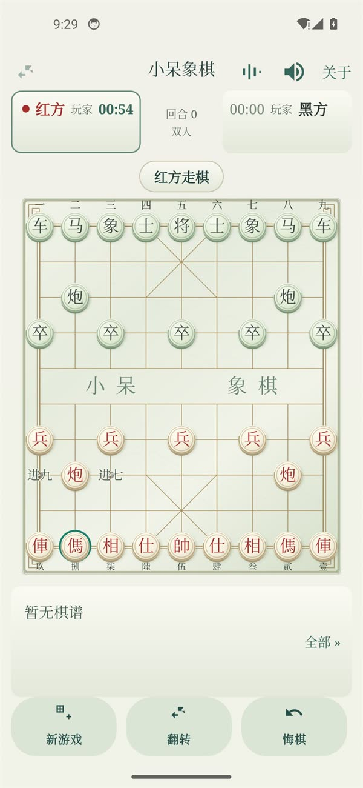</div>

<div align="center"><sub>图 4 · 选中后标出全部可行落点</sub></div>

点任意棋子，棋盘立刻用准星标出**该子的全部合法落点**，并在每个落点旁直接写出这步棋的记谱名（如上图的「进九」「进七」）。不用记规则也能看懂这匹马能跳哪。

### 4. 走错不吞回去，当场说清原因

<div align="center">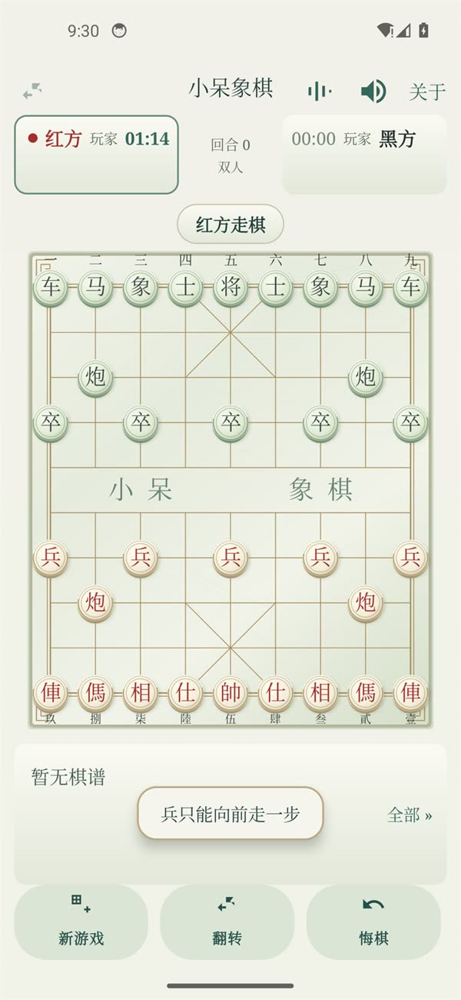</div>

<div align="center"><sub>图 5 · 走错子提示</sub></div>

把兵硬推两格、马腿被别着硬跳、炮没有炮架还想吃子——这类走法一律不被执行，并在**走棋方所在的那一侧**弹出楷体提示条说明原因（红方走错出现在棋盘下方，黑方走错出现在棋盘上方，并随文字朝向一起转 180°）。全部 20 条提示语见下方[速查表](#走法提示速查表)。

### 5. 将军一目了然

<div align="center"></div>

<div align="center"><sub>图 6 · 将军提示</sub></div>

形成将军时：状态条变为「**红方将军！**」，被将一方的将/帅被红圈圈出，两侧吃子栏与棋钟同时更新，并触发语音播报「将军」。

### 6. 被将军时不许乱走

<div align="center">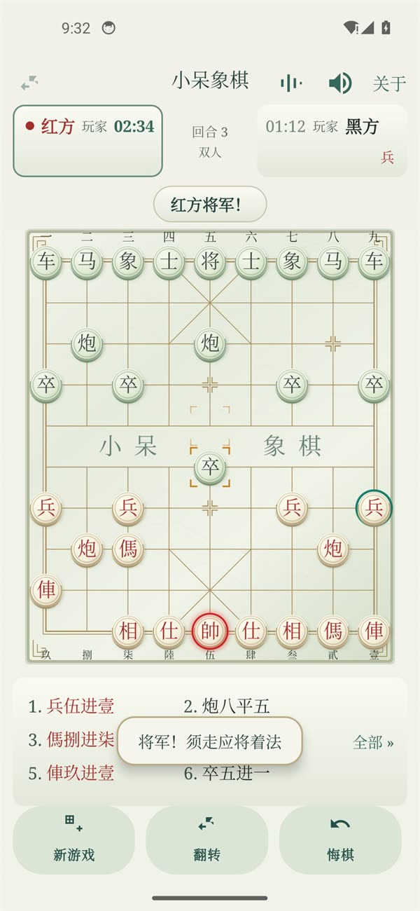</div>

<div align="center"><sub>图 7 · 须应将提示</sub></div>

己方被将军时去动别的棋子，会收到「**将军！须走应将着法**」的提示并伴随语音「保护将军」；若硬要走一步走完后仍被将的棋，语音会念「不可送将」，该步不予执行。

### 7. 悔棋：先问一句再退

<div align="center">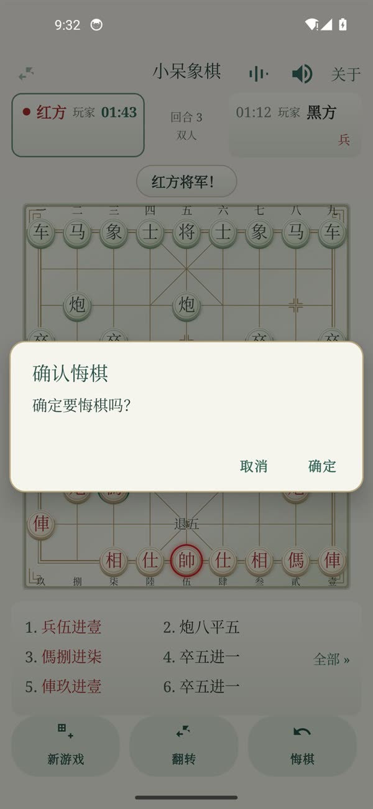</div>

<div align="center"><sub>图 8 · 悔棋确认</sub></div>

点「悔棋」先弹确认框，避免误触。人机对局回退一个回合（连 AI 的应手一起撤），双人对局回退一步；没有可悔的棋时会提示「没有可以悔的棋」。

### 8. 翻转视角与文字朝向

<div align="center">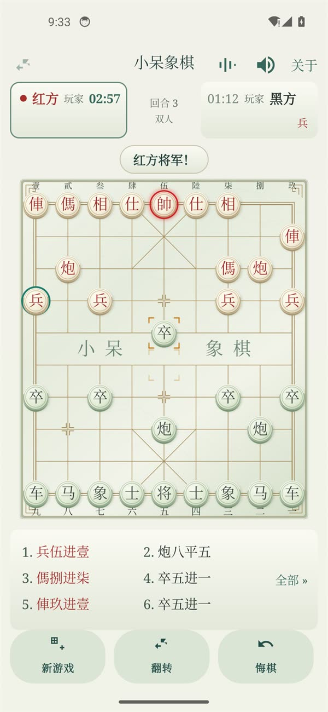</div>

<div align="center"><sub>图 9 · 翻转后黑方在下</sub></div>

**翻转**按钮在双人模式的底部中间（人机模式这个位置是「提示」），点一下立刻交换红黑视角，棋钟与吃子栏一起换边。

顶栏左上角的图标用来切换**棋子文字朝向**：开启「文字随座位翻转」时双方文字各朝自己（图 9 里黑方文字是倒着的，正是这个效果）；关闭为「文字固定正向」，全盘文字统一朝上。该按钮**只在双人对战出现**，人机对局固定正向。

### 9. 中文记谱，随时复盘

<div align="center">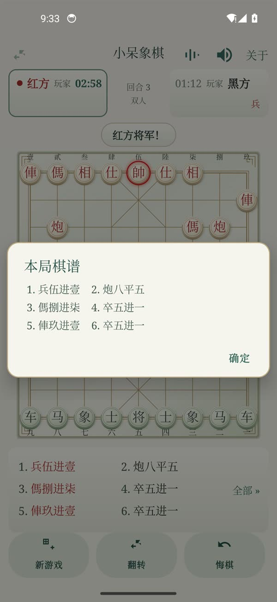</div>

<div align="center"><sub>图 10 · 本局棋谱</sub></div>

棋盘下方常驻棋谱，红黑分色、按回合两列排布；点「全部 »」弹出整局棋谱，可逐回合复盘。记谱完全按传统汉字写法（红方用 壹–玖，黑方用 一–九，如上图的「兵伍进壹」）。

### 10. 新游戏会先确认，不误删当前对局

<div align="center">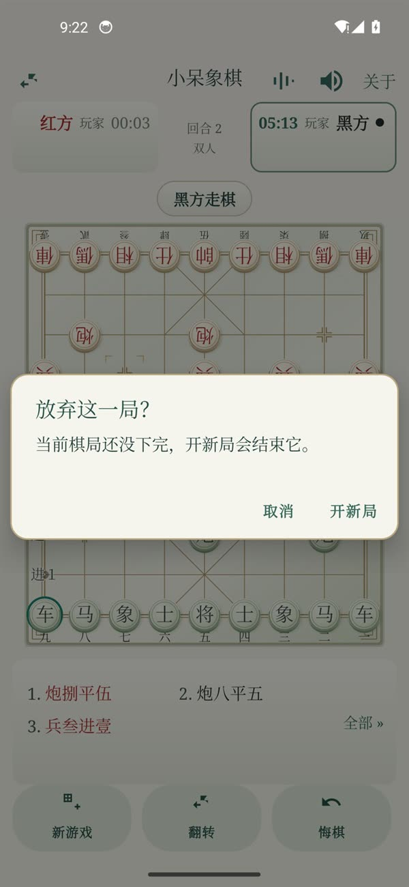</div>

<div align="center"><sub>图 11 · 新游戏确认</sub></div>

对局未结束时点「新游戏」，先弹「放弃这一局？当前棋局还没下完，开新局会结束它」，确认后才重开。

### 11. 关于页与首次启动说明

<div align="center">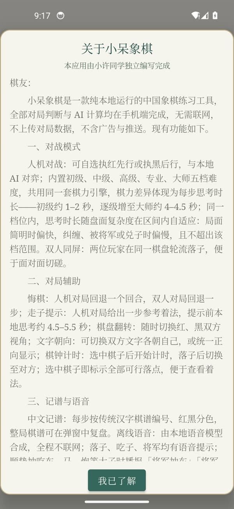</div>

<div align="center"><sub>图 12 · 关于 / 首次启动说明</sub></div>

点顶栏「关于」，或第一次打开应用，看到的都是同一份说明：模式、对局辅助、记谱与语音、规则判决、技术实现逐条列明，末尾附免责声明与开发者联系方式（QQ、QQ 邮箱、Gmail、HelloTalk，每项可一键复制）。首次启动时底部按钮是「我已了解（45 秒）」倒计时，读完才可进入；之后从「关于」打开可直接关闭。

### 12. 音效静音与语音播报，各自独立开关

<div align="center">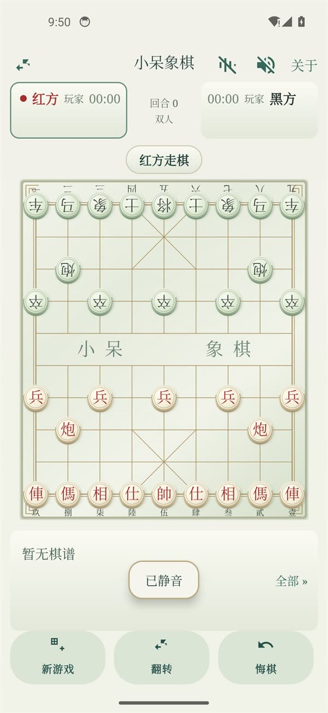</div>

<div align="center"><sub>图 13 · 点声音总开关</sub></div>
<div align="center">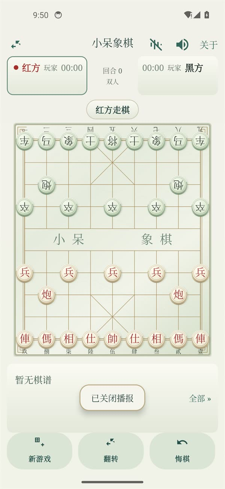</div>

<div align="center"><sub>图 13 · 已静音　│　图 14 · 已关闭播报</sub></div>

顶栏右侧两个图标分别是**语音播报**与**声音总开关**：点右边喇叭，落子/吃子音效整体静音，提示「已静音」，两个图标同时变为静音态；点左边人声图标，单独关闭或开启语音播报，提示「已关闭播报」。总开关关闭时再点语音，会先弹出「所有声音已关闭，请先打开声音总开关后重试」，避免误以为语音坏了。

<div align="center">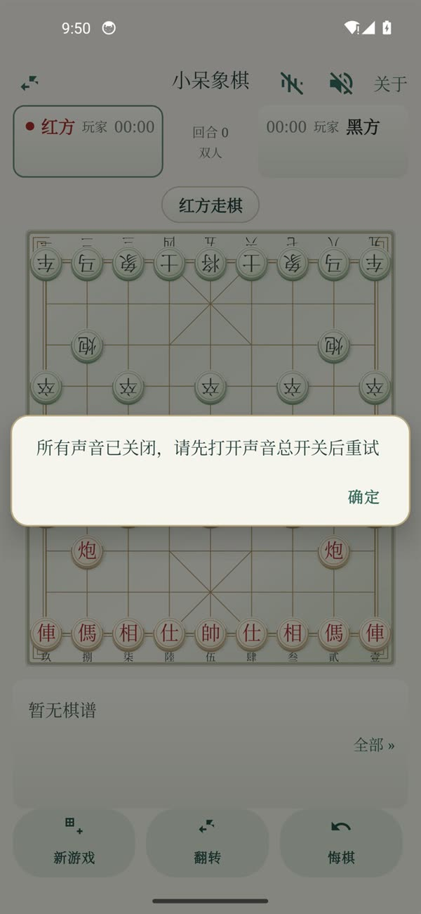</div>

<div align="center"><sub>图 15 · 总开关关闭时的拦截提示</sub></div>
---

## 功能一览

同一份清单把功能、说明和展示位置放在一起，按表往下看即可找到对应画面。

| 功能 | 说明 | 在哪看 |
| --- | --- | --- |
| 模式选择 | 我执红先手 / 我执黑后手 vs AI，或双人同屏 | 图 1 |
| 五档难度 | 初级 1–2 秒、中级 2–2.5、高级 3–3.5、专业 3.5–4、大师 4–4.5 秒每步 | 图 2 |
| 人机对局界面 | 底部按钮为 新游戏 / 提示 / 悔棋；执黑时棋盘自动翻成黑方视角 | 图 3 |
| 选中提示 | 选中即标出全部合法落点，并标注该步记谱 | 图 4，动图 4–9 秒 |
| 走子提示 | 人机模式给出一步参考着法，本地思考约 4.5–5.5 秒 | 图 3 |
| 悔棋 | 先弹确认；人机退一回合，双人退一步，无棋可悔时提示 | 图 8，动图 28–32 秒 |
| 棋钟 | 双方独立计时，选中开始，落子交接 | 图 1 / 图 4 顶部计时卡片 |
| 棋盘翻转 | 双人模式底部中间按钮，一键切换红黑视角 | 图 9，动图末段 |
| 文字朝向 | 顶栏左上角按钮；仅双人模式可切换，人机固定正向 | 图 9 |
| 走错子提示 | 20 条具体原因，逐条说明且不执行该步；提示条出现在走棋方一侧 | 图 5，动图 9–12 秒，文案见[速查表](#走法提示速查表) |
| 将军提示 | 状态条「红方将军！」并将/帅红圈标出 | 图 6，动图 18–25 秒 |
| 须应将提示 | 被将军时乱动别的子，文字 + 语音同时提示 | 图 7，动图 25–28 秒 |
| 中文记谱 | 传统汉字编号、红黑分色，棋盘下方常驻 | 图 10 |
| 棋谱弹窗 | 整局棋谱两列排布，可逐回合复盘 | 图 10 |
| 离线语音 | 落子、吃子、将军、胜负逐句播报，全程不联网 | 播报开关见 图 13 / 图 14 |
| 抽吃播报 | 将军后顺势抽吃大子，念「将军抽车」「将军抽马」「将军抽炮」 | 文字说明 |
| 杀招识别（18 种） | 对面笑、双将、重炮、马后炮、双车错、挂角马、卧槽马、钓鱼马、大胆穿心、闷宫、天地炮、花心兵、夹车炮、二鬼拍门、铁门栓、中肋炮、空头炮、三子归边，命中即念出名称 | 语音说明 |
| 音效与语音开关 | 音效静音与播报开关互相独立，总开关关闭时语音被拦截 | 图 13 – 图 15 |
| 终局判定 | 将死、困毙判负并播报；长将、长捉判负；三次重复和棋 | 见下方「终局与判罚」 |
| 新游戏确认 | 对局未结束先确认，避免误删 | 图 11 |
| 关于 / 首次启动说明 | 同一份说明；首启带 45 秒倒计时，联系方式可一键复制 | 图 12 |
| 走子规则判定 | 马腿、象眼、炮架、九宫、过河兵逐条实现 | 图 5 + [速查表](#走法提示速查表) |

### 终局与判罚

| 情形 | 判定 |
| --- | --- |
| 将死 | 被将一方无解着，判负并语音播报胜负 |
| 困毙 | 未被将军但无任何合法着法，判负并单独提示「困毙」 |
| 反复长将 | 连续将军一方判负 |
| 反复长捉 | 连续追逐对方大子一方判负 |
| 同一局面三次重复 | 判和 |

---

## 走法提示速查表

以下为应用内全部 20 条走法提示语：

| 场景 | 提示语 |
| --- | --- |
| 兵走多格 / 斜走 | 兵只能向前走一步 |
| 兵往回走 | 兵不能后退 |
| 兵未过河横走 | 兵过河后才能横走 |
| 马走非日字 | 马走日字，不能这样走 |
| 马腿被堵 | 马腿被别，走不了这一步 |
| 象走非田字 | 象走田字，不能这样走 |
| 象眼被堵 | 象眼被塞，走不了这一步 |
| 象要过河 | 象不能过河 |
| 士走非斜线 | 士走斜线，不能这样走 |
| 士出九宫 | 士不能出九宫 |
| 将帅走两格 | 将帅走直线一步 |
| 将帅出九宫 | 将帅不能出九宫 |
| 车不走直线 | 车走直线，不能这样走 |
| 车路径有子 | 车不能越子 |
| 炮不走直线 | 炮走直线，不能这样走 |
| 炮不吃子却越子 | 炮不吃子时不能越子 |
| 炮吃子无炮架 | 炮吃子必须隔一个棋子 |
| 炮吃子隔两子 | 炮吃子只能隔一个棋子 |
| 吃自己的子 | 不能吃自己的棋子 |
| 其他非法走法（兜底） | 这步棋不合法 |

将军相关另有三种独立反馈：

| 情形 | 反馈 |
| --- | --- |
| 被将军时乱动别的子 | 文字：**将军！须走应将着法**　语音：保护将军 |
| 走完后自己反而被将军 | 语音：**不可送将**（该步不执行） |
| 不是本方回合 | 文字：不是你的回合 |

---

## 应用信息

| 项目 | 值 |
| --- | --- |
| 应用名称 | 小呆象棋 |
| 版本 | 3.0（versionCode 3） |
| 包名 | `xiaodaixiangqi.zhongjiban` |
| 最低系统 | Android 7.0（API 24） |
| 目标系统 | Android 14（API 34） |
| 发布架构 | `arm64-v8a` |
| 网络权限 | 无 |
| 安装包大小 | 约 120 MB（含引擎、语音模型与离线资源） |

---

## 下载与安装

1. 打开 [Releases · v3.0](https://github.com/xiaoxu-tongxue/xiaoxu-xiangqi/releases/tag/v3.0)；
2. 下载 `xiaodai-xiangqi-3.0-nomusic.apk`；
3. 在手机上允许「安装未知来源应用」后安装；
4. 首次启动会展示使用说明（45 秒倒计时），随后选择对战模式即可开局。

APK 直链：[`releases/download/v3.0/xiaodai-xiangqi-3.0-nomusic.apk`](https://github.com/xiaoxu-tongxue/xiaoxu-xiangqi/releases/download/v3.0/xiaodai-xiangqi-3.0-nomusic.apk)

安装包 SHA-256（125,417,525 字节，约 119.6 MB）：

```text
e100ed92a1d1b755763782a69b2f3f80dce1ffba57b457b85bd2b08fa38961e8
```

```bash
shasum -a 256 xiaodai-xiangqi-3.0-nomusic.apk      # macOS / Linux
Get-FileHash .\xiaodai-xiangqi-3.0-nomusic.apk -Algorithm SHA256   # Windows
```

> 安装包只打包 `arm64-v8a` 原生库，适用于 2016 年之后的主流 Android 机型；32 位 ARM 与 x86 模拟器无法安装，需调试请见[常见问题](#常见问题)。

---

## 从源码构建

### 环境要求

| 依赖 | 版本 |
| --- | --- |
| JDK | 17 |
| Android SDK | Platform 34 + Build-Tools 34.0.0 |
| Gradle | 8.9（或使用仓库自带 wrapper） |

### 构建步骤

```bash
git clone https://github.com/xiaoxu-tongxue/xiaoxu-xiangqi.git
cd xiaoxu-xiangqi

# 指向本地 SDK
echo "sdk.dir=/path/to/Android/sdk" > local.properties

# 调试包（先验证工程是否可编译）
./gradlew assembleDebug

# 发布包（需自行配置签名，见下节）
./gradlew assembleRelease
```

产物位于 `app/build/outputs/apk/`。

### 签名

本仓库不包含任何 keystore。发布构建时请在 `app/build.gradle.kts` 中补充 `signingConfigs`，并在 `buildTypes.release` 内启用对应配置，文件内已标注注释位置。

---

## 项目结构

```text
xiaoxu-xiangqi/
├── app/
│   ├── build.gradle.kts
│   ├── proguard-rules.pro
│   └── src/main/
│       ├── AndroidManifest.xml
│       ├── java/
│       │   ├── com/k2fsa/sherpa/onnx/      # sherpa-onnx 语音合成 Java 绑定（18 个文件）
│       │   └── daidaixiangqi/app/
│       │       ├── MainActivity.kt         # 入口 Activity、界面与交互
│       │       ├── ChessApp.kt             # Application 初始化
│       │       ├── GameController.kt       # 对局状态机：走子、悔棋、提示、终局判定
│       │       ├── GameClock.kt            # 双方棋钟
│       │       ├── MoveNotation.kt         # 汉字记谱：进 / 退 / 平 与前后中
│       │       ├── Repetition.kt           # 长将、长捉与重复局面判定
│       │       ├── ai/
│       │       │   ├── ChessEngine.kt      # UCI 引擎进程管理与着法解析
│       │       │   └── ZobristHash.kt      # 局面哈希（重复局面检测）
│       │       ├── model/
│       │       │   ├── Board.kt            # 棋盘表示
│       │       │   ├── Move.kt             # 着法定义
│       │       │   ├── MoveRules.kt        # 合法着法生成 + 违规原因归因
│       │       │   ├── MatingPattern.kt    # 杀法与局面判定
│       │       │   ├── SweepCapture.kt     # 将军抽吃大子的识别
│       │       │   ├── Piece.kt / PieceColor.kt / PieceType.kt
│       │       │   └── Position.kt         # 坐标与棋盘索引换算
│       │       ├── ui/
│       │       │   ├── BoardView.kt        # 自定义棋盘绘制与手势
│       │       │   └── BoardOrientation.kt # 屏幕坐标 ↔ 棋盘坐标
│       │       └── audio/
│       │           ├── GameAudioManager.kt    # 落子 / 吃子音效
│       │           └── OfflineTtsSpeaker.kt   # 离线中文语音播报
│       └── res/
│           ├── layout/activity_main.xml
│           ├── drawable/ (纯 vector 图标)
│           └── values/ (colors / strings / styles)
├── build.gradle.kts
├── settings.gradle.kts
├── gradle.properties
├── gradlew / gradlew.bat
├── .gitattributes / .gitignore
├── docs/images/          # README 展示用截图、演示动画与视频
├── LICENSE
└── README.md
```

---

## 技术架构

**棋局内核**：`Board` 描述局面，`MoveRules` 负责合法着法生成与违规归因（「塞象眼」「别马腿」「缺炮架」等原因单独承载，只用于解释、不参与判决），`ZobristHash` 为每个局面维护增量哈希，用于长将、长捉与重复局面识别；`GameController` 作为唯一状态机，统一调度走子、计时、悔棋与终局判定。

**AI 引擎**：以 UCI 协议与 Pikafish 引擎通过标准输入输出交换 `position` / `go` / `bestmove`；NNUE 网络文件首次启动复制到私有目录，避免冷启动重复解包；思考时间按盘面复杂度（子力密度、合法分支数、是否被将军、是否兑子）在档位区间内自适应采样。

**语音播报**：通过 sherpa-onnx 的 JNI 接口加载本地中文模型，在设备端完成合成；构文（吃子名、将军判定、抽吃识别、记谱成句）在回调线程算好，合成线程一醒即可推理，开场用一句最短的「将军」做算子热身。

**棋盘渲染**：`BoardView` 为自定义 View，Canvas 逐帧绘制棋盘、棋子、选中态、准星式落点标记与记谱标注；`BoardOrientation` 负责屏幕坐标与棋盘坐标互转，翻转与文字朝向都在这一层解决。

**构建体系**：Gradle Kotlin DSL + AGP 8.7.3 + Kotlin 2.0.21，release 开启代码压缩与资源裁剪。

---

## 可选二进制资源

为保证仓库纯净，以下二进制资源未纳入源码。缺少它们时工程仍可编译、可开局，双人对弈完全可用，仅对应增强功能不可用；如需完整功能，请自行获取并放到指定位置：

| 功能 | 所需文件 | 放置位置 |
| --- | --- | --- |
| 人机对弈（Pikafish） | `libpikafish.so`、`pikafish.nnue` | `app/src/main/jniLibs/arm64-v8a/`、`app/src/main/assets/` |
| 离线语音播报 | `zh_CN-chaowen-medium.onnx`、`phone.fst`、`tokens.txt`、`lexicon.txt`、`*.onnx.json`、`libsherpa-onnx-jni.so` | `app/src/main/assets/tts/`、`app/src/main/jniLibs/arm64-v8a/` |
| 落子 / 吃子音效 | `move_piece.wav`、`capture_piece.wav` | `app/src/main/res/raw/`（在 `GameAudioManager.kt` 对应 TODO 处接回 SoundPool） |
| 楷体字体 | `app_kai.ttf` | `app/src/main/res/font/`（并将 `serif` 改为 `@font/app_kai`） |

---

## 常见问题

**Q：能否在模拟器上运行？**
A：发布包仅打包 `arm64-v8a`，请使用 arm64 真机或 arm64 系统镜像。若在 x86_64 模拟器上调试，可先移除原生库依赖编译纯 Kotlin 版本——此时对弈与记谱正常，AI 与语音不可用。

**Q：为什么棋盘上黑方文字有时是倒着的？**
A：这是「文字随座位翻转」的效果，双人面对面时各自看自己的字是正的。点顶栏左上角图标可切换为「文字固定正向」；该按钮只在双人对战显示，人机对局固定正向。

**Q：会联网吗？会上传棋谱吗？**
A：不会。应用未申请网络权限，对局记录与设置仅保存在本机。

---

## 版本说明

### v3.0

- **界面**：顶栏标题居中；文字朝向按钮移到左上角（仅双人模式显示），双人模式底部中间按钮为「翻转」，与语音 / 静音 / 关于分开
- **音频**：移除全部背景音乐、音乐菜单与音乐播放逻辑，仅保留落子 / 吃子音效与语音播报
- **资源**：字体改用系统 `serif`，启动图标改为纯 vector，工程不再依赖 png / ttf 二进制
- **规则**：完善长将、长捉、困毙与重复局面的终局判定
- **提示**：非法走法给出具体原因，被将军时区分「须应将」与「不可送将」

---

## 参与贡献

欢迎提交 Issue 与 Pull Request。提交前请确保：

1. `./gradlew assembleDebug` 能通过；
2. 不引入运行时二进制（`.so`、`.apk`、字体、音频等）；`docs/images/` 下的 README 展示素材属于例外；
3. 代码风格与现有模块一致，新增逻辑附带必要注释。

---

## 许可证

本项目基于 [MIT License](LICENSE) 开源。

第三方组件：[Pikafish](https://github.com/official-pikafish/Pikafish) 与 [sherpa-onnx](https://github.com/k2-fsa/sherpa-onnx) 为独立开源项目，许可证以各自仓库为准；本仓库仅包含与它们对接的源码，不含其二进制与模型文件。

---

## 免责声明

本项目为个人学习与技术实践作品，按现状（AS IS）提供，不构成任何形式的明示或默示担保。因使用本软件产生的任何直接或间接损失，作者不承担责任。请勿将本软件用于涉及利益的正式赛事判定场合。

<div align="center"><sub>Made with ❤️ by 小许同学 · Xu Studio</sub></div>
